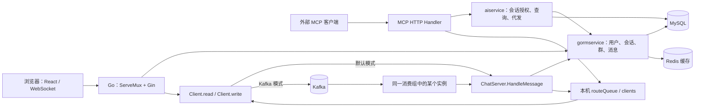
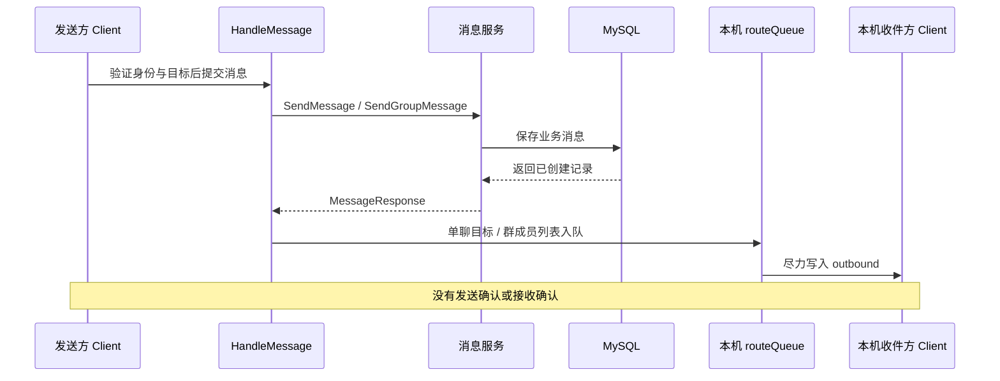

# Fable Chat 总架构

| 项目 | 内容 |
| --- | --- |
| 文档状态 | 新 Logic 交付说明与旧单体回归参照；目标设计已接受，三角色迁移进行中 |
| 维护者 | 仓库维护者；修改相关链路的 PR 作者负责同步本文 |
| 读者 | 开发者、评审者和部署维护者 |
| 核对基线 | 旧单体说明基于 [2d85cdb](https://github.com/LosAveRoad/fable/commit/2d85cdbf1f229deb4fa17518ff7a1c419a08a893)；新 Logic 以本轮实现和测试为准 |
| 验证边界 | 隔离真实后端与 Logic/Comet 组件联调；未验收完整公开 WS 三角色链路、线上容量或 K8s |

## 当前 Logic 交付

新入口 `cmd/logic` 独立提供 HTTP/MCP 与 LogicService，不持有 WebSocket、不消费 Kafka。用户/会话/群/联系人接口沿用原 Handler，MCP 发送和 Comet SubmitMessage 统一经过 Logic 编排：权威授权→MySQL 事务/幂等/稳定收件人快照→Kafka 推送任务。消息提交后发布失败保留 stored=true 和降级 dispatch；同步直接查询数据库，以客户端同 ID 重试和历史补拉修复首期双写窗口。

Redis 路由由 Logic 的 Lua 原子管理，显式角色凭据绑定 Comet instance/boot/address。真实 Comet 实例客户端可注册/续租/条件注销，用户路由注册/续租、查找及替换后的 Kick 已通过跨组件测试。新服务正常启动只校验目标 schema；初始化只允许独立空库。现有旧查询缓存在新 Logic 中关闭，旧单体环境仍可保留原缓存实现。

HTTP 业务接口与元数据同源生成 OpenAPI 3.1，CI 比较生成物并运行路由/响应契约测试；PR 模板和 Action 检查文档影响声明。职责及语义继续参考 Logic/Comet/Job 契约，RPC 字段仍以 .proto 为准。

当前验证覆盖真实 MySQL、Redis、Kafka、Logic RPC 与两个 Comet，以及真实 HTTP/MCP。测试中的编排 Publisher 捕获与实际 Kafka adapter 验证分别记录。尚无 Comet 公开用户 WS 接入、完整 Job 消费/offset/DLQ、v2 前端或新拓扑部署脚本，不能据此宣称完整端到端聊天迁移完成。

下文保留旧单体的运行路径与问题作为隔离回归参照；它不描述新 Logic 入口。

## 旧单体概要

Fable 将 HTTP 业务接口、WebSocket 连接和 MCP 工具放在同一个 Go 进程中。MySQL 保存业务数据，Redis 缓存查询结果；每个进程单独维护本机 WebSocket 连接表。AI 由 Codex 等外部 MCP 客户端承载，Fable 提供授权后的聊天工具。

当前存在两条普通消息入口：默认直接调用消息服务；启用 Kafka 后，先发布事件，再由消费者调用同一消息处理函数。两条路径最终都只向消费者或调用者所在进程的连接表投递。现有双副本部署缺少跨实例路由，不能保证在线收件人收到消息。

本文集中说明现状、约束和待决问题。字段、路由和配置清单链接到源码；未实现功能不会因为出现在文档中而成为已交付能力。

Logic / Comet / Job 的目标架构与迁移步骤见[已接受的迁移设计](design/goim-migration.md)，DTO / RPC 的接口细化见 [Spec](../api/proto/README.md)。目标设计不替代本文对当前运行代码的说明。

迁移组件 [internal/comet](../internal/comet) 包含投递内核及实例租约客户端，已与新 Logic 验证注册/续租/条件注销和替换连接的 Kick。公开 WS、用户连接读写生命周期与独立 Comet 进程仍待实施；旧入口继续使用下文的单体运行路径。

[internal/job](../internal/job) 提供单任务推送内核，通过 Logic RPC 解析路由并定向调用 Comet；用两个真实 Comet RPC 服务测试部分结果、路由修复和有界重试。Job 内核的隔离测试使用 Logic 测试替身；真实 Logic 已由独立入口提供，但 Job 尚无 Kafka 消费循环、offset 提交、DLQ 写入或独立入口，不构成可运行的三角色链路。

## 目标与范围

当前系统服务于文本单聊、已有群聊业务和用户授权的 MCP 操作。本文帮助维护者定位业务边界、追踪一条消息，并判断修改会影响哪些数据与失败场景。

以下旧单体分析保留其问题边界，不把旧部署样例视作新架构交付。内置 LLM/Agent Runtime、群聊 AI 任务、待办工具和 WebRTC 通话均没有在当前代码中形成实现闭环。

## 组件与职责



图中的连接表始终是本机状态；Kafka 消费实例与收件人的连接实例之间没有路由关系。

| 组件 | 职责与源码入口 |
| --- | --- |
| 进程入口 | [main.go](../cmd/my_chat_server/main.go) 加载配置、初始化依赖，挂载 `/healthz`、`/mcp` 和 Gin，处理终止信号 |
| HTTP 接入 | [https_server](../internal/https_server/https_server.go) 注册路由；[api/v1](../internal/api/v1) 解析参数、取得身份并调用服务 |
| 聊天连接 | [chatservice](../internal/service/chatservice) 管理 Client、连接替换、本机投递及两种入口共享的业务处理 |
| 业务与持久化 | [gormservice](../internal/service/gormservice) 访问全局 DAO 并执行用户、会话、群和消息规则 |
| MCP | [mcpserver](../internal/mcpserver) 提供 Streamable HTTP、工具注册、Schema 与结果转换 |
| AI 授权服务 | [aiservice](../internal/service/aiservice) 检查会话白名单、限制查询并复用消息持久化 |
| 外部适配 | [dao](../internal/dao)、[redisservice](../internal/service/redisservice)、[kafkaservice](../internal/service/kafkaservice/service.go) 管理连接、缓存和事件传输 |
| 浏览器前端 | [main.jsx](../web/chat-server/src/main.jsx) 提供登录、单聊会话、历史查询和实时消息展示 |

这是一个包含多个包的单体应用。每个副本同时承担接入、业务、连接管理及可选 Kafka 消费职责，没有独立的投递 Worker 服务。

## 数据与状态所有权

### MySQL

表结构和索引以 [model](../internal/model) 为准，启动迁移见 [gorm.go](../internal/dao/gorm.go)。

| 数据 | 当前表达 |
| --- | --- |
| 用户 | `user_info` 保存公开 UUID、手机号、昵称和 bcrypt 密码哈希 |
| 单聊会话 | `session` 将两名用户 UUID 排序后保存，同一对用户共享一条会话；`send_id` 不代表固定发送方向 |
| 群会话 | `session.type` 区分群记录；`send_id` 为所属用户，`receive_id` 为群 UUID |
| 消息 | `message` 保存服务端 UUID、正文、来源和收发方；单聊 `session_id` 为会话 UUID，群消息当前直接使用群 UUID |
| 群与关系 | `group_info` 的 members/admins 为 JSON；`user_contact` 保存关系，`contact_apply` 保存申请 |
| AI 授权 | `user_ai_session_access` 保存用户明确允许 AI 访问的会话 |

数据库是持久化业务记录的来源。当前消息没有客户端幂等 ID、会话 sequence 或 delivered/read 状态；服务端 UUID 唯一不能阻止同一次请求重试后生成新记录。AutoMigrate 随每个进程启动执行，尚无独立的版本化迁移与回滚流程。

### Redis

[keys.go](../internal/service/redisservice/keys.go) 定义带 `fable:v1:` 前缀的用户、会话、群、成员及消息缓存 Key。常用查询先读缓存，未命中或出错后查询 MySQL；常规缓存 TTL 为 10 分钟。

消息缓存的 [AppendJSON](../internal/service/redisservice/message_cache.go) 执行读、追加和覆盖写，未使用原子追加或版本校验，并发写入可能丢失缓存项。完整历史查询后写回缓存也存在竞争窗口。MySQL 中有数据不代表缓存一定立即反映全部数据。

Redis 未保存连接所属实例，也没有参与聊天链路的 presence 心跳或跨进程转发。`required=false` 时初始化失败可继续启动；运行时多数缓存错误被忽略或回源，仍需考虑连接超时造成的延迟。

### 进程内连接

`Server.clients` 是 `userUUID → Client` 的本机映射，由 `Server.Start` 事件循环独占修改。同一进程同一用户的新连接替换旧连接；旧 Client 注销时必须与当前指针相同才会删除记录。该策略不构成跨实例的单端登录控制。

每个 Client 有一个读协程、一个写协程和有界 outbound 队列。队列满时关闭慢连接。本机 `RouteTo` 返回成功仅表示任务入队，不表示找到在线用户、写入 WebSocket 或被接收方确认。

## 核心请求与消息链路

### HTTP 与 WebSocket 身份

HTTP 使用 JWT Bearer Token，WebSocket 在 Upgrade 前验证查询参数 `token` 或 Bearer Token，身份写入 `user_uuid` 上下文。`Client.read` 还要求消息中的 `send_id` 与该身份一致。具体规则见 [auth_middleware.go](../internal/https_server/auth_middleware.go) 和 [client.go](../internal/service/chatservice/client.go)。

WebSocket 帧以 [wschat.Message](../internal/dto/wschat/chat.go) 为准，当前是平铺字段。`receive_type` 为 0 时表示单聊，为 1 时表示群聊。协议没有事件信封、发送确认、客户端请求 ID 或状态通知。HTTP 成功与错误响应也尚未统一为一套结构；调用方应依据各 Handler 和测试，不能假定所有返回都包含 `data`。

### 默认普通消息路径



单聊服务检查双方会话存在；群聊服务检查发送者在成员列表中。群成员再用于本机扇出。用户离线、慢连接关闭或进程退出不回滚已落库消息。历史接口可用于重新读取，但普通聊天接口目前全量查询，浏览器也没有自动重连补拉流程。

普通单聊只向接收方实时推送；前端发送后直接本地回显。因此页面出现消息不能作为落库或投递成功的证据。入口中的 `mode="channel"` 表示不经过 Kafka，并不提供持久消息队列。

### Kafka 模式

启用条件为 `enabled=true` 且 `mode="kafka"`。初始化成功后，进程设置全局 `PublishChatEvent`；读循环据此切换到发布事件。实际路径为：

```text
Client.read → Kafka Publish → FetchMessage
→ HandleMessage → MySQL → 本机 routeQueue → CommitMessages
```

最后两步中，入队完成即可返回并提交 offset，投递循环可能尚未执行。生产端使用 Hash 分区和 `RequireAll`；单聊 Key 为 `sender:receiver`，群聊 Key 为群 ID。单聊双向消息可能落到不同分区。Kafka ACK 确认的是 Broker 写入，不是 MySQL 落库或客户端收件。

消费者处理成功后显式提交 offset。JSON 无法解析或缺少 EventID 时直接跳过，没有死信记录；handler 或提交出错则退出消费循环。`main.go` 仅记录消费退出日志，不重启循环或退出进程。`EventID` 在业务回调中被丢弃，落库后、提交前的重放可能再次生成消息。

**跨实例失败示例：** B 连接实例 2，但消息分区由实例 1 消费。实例 1 成功落库和本机入队；其连接表没有 B，投递失败被忽略，offset 仍可提交。增加分区或副本不会建立连接路由。实现依据见 [Kafka 服务](../internal/service/kafkaservice/service.go)、[入口回调](../cmd/my_chat_server/main.go) 和 [本机投递](../internal/service/chatservice/server.go)。

若启动时 Kafka 初始化失败且 `required=false`，读循环继续使用默认路径；初始化成功后的发布失败只写日志，没有自动切回默认路径或待投递恢复机制。

### MCP 与 AI 权限

当前工具只有 `list_sessions`、`get_recent_messages`、`search_messages` 和 `send_message`，注册入口与 Schema 见 [register.go](../internal/mcpserver/tools/register.go) 和 [contract](../internal/mcpserver/contract)。外部客户端承担模型推理与编排，Fable 没有后台 `ai_jobs`、内置 AI 用户或待办表。

MCP HTTP 使用与聊天相同的 JWT。AI 服务同时校验用户属于会话，以及 `user_ai_session_access` 显式授权。当前产品链路面向授权的单聊会话，不承诺完整的群聊 AI 能力。

`send_message` 仅接收会话 UUID 和正文，服务端推导发送者及对端。授权服务调用 `SendAIMessage` 落库，工具层再向双方执行本机 `RouteTo`。该路径绕过 Kafka；更改普通 WebSocket 消息传输方式不会自动修复 MCP 跨实例投递。实现见 [send_message.go](../internal/mcpserver/tools/send_message.go)。

AI 消息通过 `OriginAI` 标识来源，没有独立的工具审计流水。工具声明为非幂等，客户端不应自动重试发送；提示词中的“明确要求发送”指导外部客户端行为，不能替代服务端授权校验。MCP 最近消息查询有数量上限和游标，不能据此推断普通 HTTP 历史接口也具备分页。

## 部署、生命周期与观测

配置先读取 `config/config.toml`，再应用 [config.go](../internal/config/config.go) 中显式支持的环境变量。主进程固定监听 `:8080`。`partitionCount` 虽在 TOML 结构中存在，但没有被应用代码用于创建 Topic，`FABLE_KAFKA_PARTITION_COUNT` 也没有环境覆盖实现。

仓库提供了本地 [Compose](../docker-compose.yml)、外部数据库主机样例和 K8s 清单。K8s 应用设为两个副本，Kafka 样例为单 Broker；这些文件是部署材料，不是已通过多实例可靠性验证的证据。文件组合、端口差异、Topic 初始化和镜像前提见 [部署说明](../deploy/k8s/README.md)。

前端工作流独立构建并发布静态资源。后端镜像只复制二进制和配置，未包含前端资源；Gin 中 `/chat` 的静态挂载不能证明该镜像可提供网页。

收到 SIGINT/SIGTERM 时，进程取消共享 context，调用带 5 秒期限的 HTTP Shutdown，随后执行 defer 清理本机 Client 和依赖。没有应用层排空协议、Redis 连接租约或客户端自动重连补拉。此行为不能视为长连接无感滚动迁移。

`/healthz` 无条件返回 200。现有 readiness/liveness 都访问它，因此消费者退出、路由缺失或依赖运行中故障可能不会体现在探针上。当前没有业务成功率、投递延迟和消费循环存活的完整指标闭环。

## 关键取舍与替代方案

此表说明代码已经采用的结构及其代价，不表示项目曾完成正式方案评审。

| 当前选择 | 收益与代价 | 后续比较方向 |
| --- | --- | --- |
| 单进程承载接入、业务与 MCP | 部署与共享业务逻辑直接；生命周期和故障互相耦合 | 先验证边界，再决定是否拆服务 |
| 连接表由事件循环独占 | 所有权清晰，避免分散加锁；仅覆盖本机连接 | 保留本机所有权，另行设计跨实例路由 |
| MySQL 持久化、Redis 缓存 | 缓存可丢弃；当前缓存并发更新与失效仍有窗口 | 比较删除缓存、原子操作和版本策略 |
| 群成员 JSON | 结构简单；成员操作、查询和并发维护成本上升 | 依据规模与约束比较独立成员表 |
| Kafka 接收后再执行业务 | 业务可以异步执行；发送者不能直接获得业务成功结果 | 比较命令队列与落库后事件，各自定义确认和恢复 |
| 外部 Agent + MCP | 复用外部推理；依赖外部客户端的调用与发送策略 | 内置 Agent 属于独立产品能力，不隐含在当前方案中 |

## 已知缺口与待决问题

以下均是待处理项。本次文档 PR 不修复，也不将演进建议视为已接受的方案。

| 问题 | 需要决定或验证的行为 |
| --- | --- |
| 消息成功的含义 | 区分接收、落库、在线投递和已读；定义稳定 ID、重试和确认协议 |
| 跨实例投递 | 决定连接归属与转发机制、群聊扇出及连接迁移；同时覆盖普通聊天与 MCP |
| Kafka 是否继续处于主链路 | 先证明用途，再决定命令或事件语义；定义幂等、重试、坏消息与失败恢复 |
| 消费故障可见性 | 业务拒绝不应结束全部消费；运行故障须能被监测并恢复 |
| 历史与缓存一致性 | 历史分页、并发缓存更新、断线补拉和客户端去重需要形成闭环 |
| 安全边界 | 当前 WebSocket 接受任意 Origin；消息大小、读写期限、限流及工具审计仍需完善 |
| 发布与依赖故障 | 完成排空、重连、迁移和恢复验收后，再讨论多副本可用性 |

建议先补齐单实例可靠性，再验证本地双进程投递，最后验收 K8s 发布。候选跨实例方案可以比较按实例寻址的 RPC/消息通道，以及带可靠记录的异步投递。直接给每个 Pod 独立消费组会扩大消费和重放范围；把当前落库 handler 广播给每个 Pod 还会导致重复入库，不能作为路由修复。

如果选择落库后发布事件，应同时设计数据库提交与事件发布之间的失败恢复，例如事务 Outbox；如果保留先入 Kafka 的命令路径，则应明确异步业务结果及消费者幂等。二者都需要独立设计与验证，本文件不替未来实现作选择。

## 验证依据与验收边界

| 材料 | 可以说明什么 | 不能证明什么 |
| --- | --- | --- |
| [连接单元测试](../internal/service/chatservice/server_test.go) | 本机注册、连接替换、路由和慢客户端策略的测试范围 | 跨实例路由和 Kafka 重放 |
| [集成测试](../internal/integration) | 单个 ChatServer 下 HTTP、WebSocket、群聊及 MCP 链路的用例 | 多进程、真实 Kafka 和滚动发布 |
| [CI](../.github/workflows/ci.yml) | 配置 MySQL/Redis 并运行单元与集成测试 | 实际执行结果；工作流没有启动 Kafka，也没有执行 race detector |
| [压测脚本](../tests/load/README.md) | HTTP 基线、只读业务和连接建立场景 | 跨 Pod 消息成功率、端到端投递延迟或容量结论 |

执行方式见 [测试环境](test-environment.md)。每份新验收结果应包含提交 SHA、依赖/部署拓扑、命令、预期与实际结果以及原始证据。方案被接受、代码已合入和行为已验证应分别记录；只存在清单或测试代码不等于验收通过。

## 文档维护

本文是当前架构唯一入口。README 提供导航，测试与部署文档只维护各自操作，字段、Schema 和可执行契约优先链接源码及测试。旧规划可从 [Git 历史快照](https://github.com/LosAveRoad/fable/tree/2d85cdbf1f229deb4fa17518ff7a1c419a08a893/docs) 阅读，不再作为当前需求或完成证明。

修改身份、消息路径、存储职责、配置或部署行为的 PR，应在同一次变更中同步相关文档。PR 描述需回答是否影响文档，列出更新位置或无需更新的理由。当前尚未添加自动检查或 required status check，这是一项待落实的协作规则。

文档组织参考 Google 的 [Documentation Best Practices](https://google.github.io/styleguide/docguide/best_practices.html) 和 [Documentation](https://abseil.io/resources/swe-book/html/ch10.html)：保持少量准确文档，明确维护者，避免重复，并将设计决策历史与当前操作说明分开。本文中的目录与状态字段是 Fable 的轻量约定。
