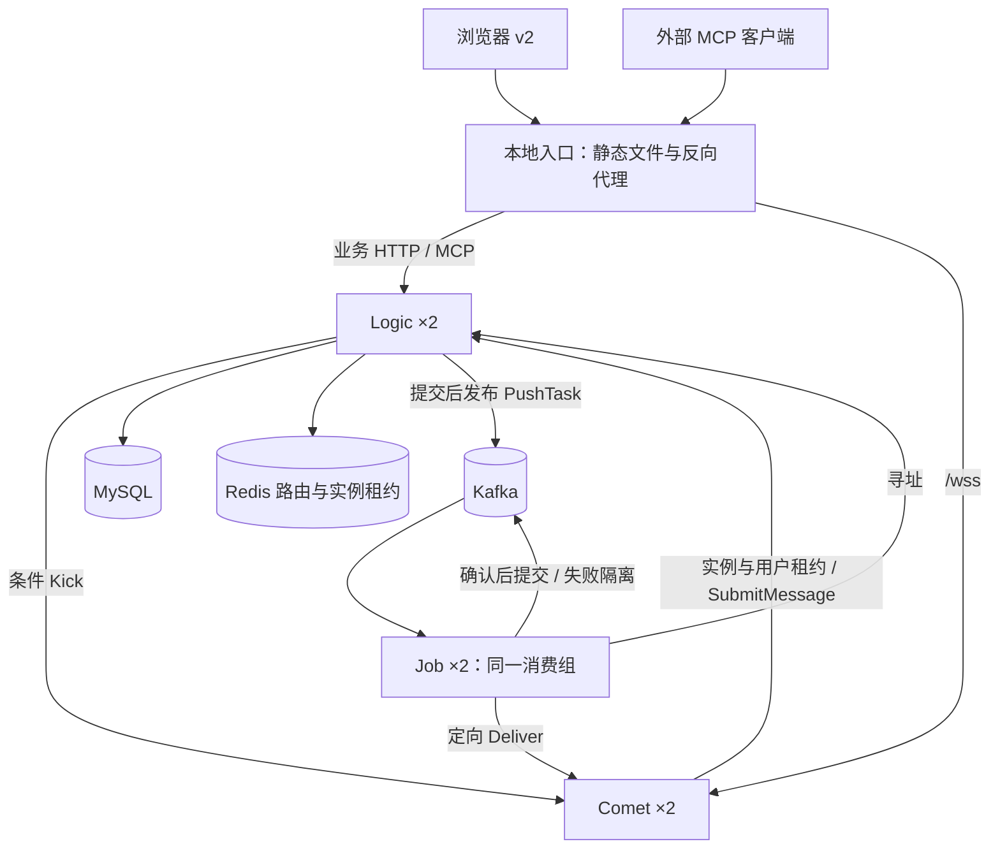

# Fable Chat 总架构

| 项目 | 内容 |
| --- | --- |
| 状态 | 已实现的三角色本地开发架构；AKS 交付准备中，尚无云端运行证据 |
| 维护者 | 仓库维护者；改变职责、流程或故障语义的 PR 作者同步本文 |
| 核对日期 | 2026-11-02；以本分支源码与实际测试为准 |
| 设计基线 | [已接受的迁移设计](design/goim-migration.md)，作为决策基线保留，不反复改写实施进度 |
| 验证边界 | 真实 MySQL、Redis、Kafka，两个 Logic、两个 Comet、两个 Job；容量、跨机 TLS、K8s 不据此完成 |

## 目标与架构选择

Fable 是 Go 聊天学习项目，保留注册、登录、用户、联系人、会话、群、文本消息和用户授权的 MCP 工具。参考 goim 的职责边界，把原先同时持有连接、执行业务和消费 Kafka 的进程拆开；不直接引入整套 goim，也不借迁移重写全部业务分层。

本阶段提供持久消息、尽力在线推送和客户端权威同步修复。数据库提交、Kafka ACK、Comet 入队和消费提交分别表达不同阶段，均不等于对方客户端已收到。

本地入口只负责转发与静态文件，不是第四个消息业务角色。脚本默认以 2/2/2 拓扑验证实例之间没有本机连接依赖；各角色也有独立启动命令。

## 职责与状态所有权

| 组件 | 所有权与入口 |
| --- | --- |
| Logic | [cmd/logic](../cmd/logic)；现有 HTTP/MCP、业务授权、MySQL、Redis 路由、Kafka Producer；[角色契约](contracts/logic.md) |
| Comet | [cmd/comet](../cmd/comet)；公开 WebSocket、用户与实例租约、本机 Hub/队列、Deliver/Kick/Drain；[角色契约](contracts/comet.md) |
| Job | [cmd/job](../cmd/job)；分区消费、定向投递、重试、DLQ 与人工重放；不写消息数据库；[角色契约](contracts/job.md) |
| MySQL | 用户、联系人、会话、群、AI 白名单和权威消息；新消息同时保存幂等指纹与完整收件人快照 |
| Redis | 连接在哪个 Comet、连接身份、JWT 截止、实例地址/boot/draining 与期限；仅 Logic 修改 |
| Kafka | 已落库推送任务及死信；不是新的业务持久化入口，不消费旧待落库命令 Topic |
| 浏览器 | 单个已登录账户的乐观发送、消息 ID 合并、会话同步游标与连接恢复；[客户端源码与测试](../web/chat-server/src) |

普通用户管理与历史接口继续使用现有 Handler/Service。新 Logic 关闭旧查询缓存，权限与历史读权威数据库。新空库只显式初始化一次；正常服务启动校验结构，不自动修改已有表。

## 主要调用链

**连接与寻址。** Comet 先监听内部 RPC，再以明确 instance/boot/address 和服务凭据注册。公开接入检查握手、Origin、协议与 JWT，Logic Connect 再校验用户/实例；成功后才激活本机连接。续租与注销匹配完整身份，旧连接不能删除新路由。实例失效、JWT 到期或安全截止到达关闭连接；路由替换后的 Kick 尽力异步执行，不承诺跨实例瞬时单活屏障。

**普通消息与群消息。** Comet 从连接身份确定 sender，经 Logic 检查当前路由和业务权限。事务先锁发送用户，再锁单聊会话或群，覆盖 ID 分配至提交；同时保存消息、指纹和排序后的稳定收件人快照。同 sender/client_message_id 重试只创建一条记录，改变内容、目标或来源会冲突。群 session_id 保持群 UUID。提交成功后发布每片最多 100 个收件人的任务，包括离线成员；Job 不重新查群成员或再次落库。

**MCP。** 原四个工具保留，查询与代发均需要当前身份、会话资格和显式 AI 白名单。代发进入同一个 Logic 编排，保留 TrimSpace/4000 字符边界与 OriginAI。独立 Logic 使用逐请求鉴权的无状态 MCP HTTP，可以轮询至不同 Logic；不靠进程内 session 或浏览器粘性修复服务耦合。

**投递与消费。** Job 以实例地址解析和完整连接身份定向调用 Comet，地址只来自 Logic。每分区一次只有一个未确认处理周期；所有目标已入队、确认离线或成功写 DLQ 后才提交原 offset。DLQ/commit 失败不能跨过当前任务；generation 取消交由新持有者重放。近期冲突检测和客户端去重有明确容量边界，不是永久全局投递去重。

**浏览器与同步。** 显式 v2 握手，先订阅实时消息再分页同步；同步期间合并缓冲，按 message_id 去重。位置字符串以 BigInt 比较，只有成功合并的同步页能推进游标。重连、切换会话、保存不确定和 30 秒轮询触发修复；同一次发送重试保留原 ID/正文/目标，queued 不显示成已送达。没有接收确认关联时保留“保存未确认”，不按相同文本猜测消息身份。

## 可靠性与故障边界

| 场景 | 行为与恢复 |
| --- | --- |
| MySQL 提交前失败 | 不确认 stored；身份仍有效时可同 ID 重试 |
| 数据库提交后、Kafka 发布前退出 | 首期无 Outbox/扫表发布器；通过同 ID 重试或权威同步恢复 |
| 发布响应不确定或多片部分成功 | stored=true，dispatch=unknown；允许重复推送，客户端合并 |
| Comet 慢连接、换实例或进程退出 | 有界队列与精确身份；路由修复/有界重试，超限隔离或上线同步 |
| Job 投递后、commit 前退出 | Kafka 可能重放；不再次落库，客户端仍按 ID 合并 |
| 未知或损坏任务 | DLQ 保存原始字节，不丢字段重编码，也不自动重放无效任务 |
| Redis/实例租约丢失 | 停止沿用本机身份；关闭相关连接，重新建立新连接 |

单聊/群消息正文最多 16 KiB，任务最多 256 KiB；应用 Socket 帧允许 128 KiB 编码空间以容纳转义。Gorilla 的致命协议错误 Close 控制写是库支持的并发例外，其余应用数据和正常控制帧由同一写协程处理。详细状态和重试语义由三个角色契约维护，不在本文复制字段表。

## 运行、安全与验证

默认新入口为 [dev-up.sh](../scripts/dev-up.sh)，操作与配置见[本地部署](../deploy/local/README.md)。监听、注册地址与内部 RPC 目标限回环，Origin 采用明确允许列表；跨主机之前需要单独处理 TLS/mTLS 与网络隔离。服务角色凭据和 JWT 分开，运行密钥放在忽略的私有文件中，日志不包含令牌、正文或依赖错误原文。

各角色分别提供存活、就绪和有界指标；日志关联 request_id、message_id、task_id 与消费位置。就绪依赖与实际冒烟分别核对，不以旧常量 healthz 证明消息链路。HTTP 字段与状态来自代码同源生成的 [OpenAPI](../api/openapi/README.md)，RPC 来自 [.proto](../api/proto/README.md)；PR 必须声明文档影响。

[测试环境](test-environment.md) 记录真实后端、race、旧业务回归及多进程验收的执行入口。已验证 100 条双向跨实例单聊、三用户群聊、MCP 代发、重复 ID 单行、Job 停止期间排队与恢复、连接迁移 Kick、离线分页修复和坏消息 DLQ；前端另有状态/传输测试与实际浏览器核对。独立的公开黑盒流程与有界消息负载使用相同公共入口，命令和结果边界见[压测与黑盒说明](../tests/load/README.md)。不据此声明负载容量、生产 SLO、多 Broker 容灾或端到端已读。

## 文档生命周期

旧部署文件与自动发布工作流已移除。当前可运行入口为三角色本地拓扑，既有业务回归在隔离测试环境保留。AKS 交付准备采用集群内测试依赖，但尚无 Azure 订阅，未创建资源、验证跨主机部署或测得云端容量。

旧单体的问题分析可查[历史快照](https://github.com/LosAveRoad/fable/tree/2d85cdbf1f229deb4fa17518ff7a1c419a08a893/docs)，当前文档不并行维护第二份旧架构。宏观迁移设计保留已接受的决策，实施进度归 [Issue #7](https://github.com/LosAveRoad/fable/issues/7)，当前运行行为归本文和角色契约。
