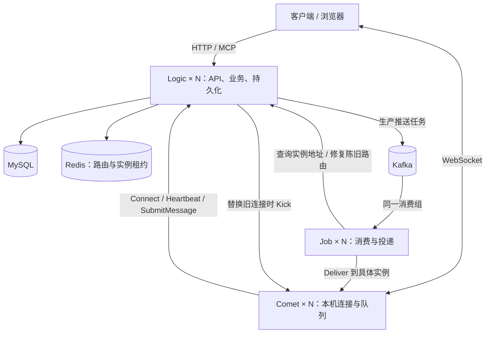
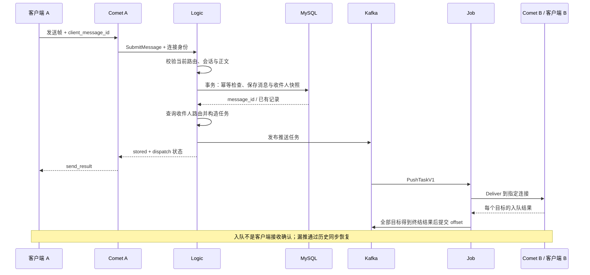

# Design: 将 Fable 迁移为 Logic、Comet、Job 三种角色

| 项目 | 内容 |
| --- | --- |
| 状态 | Accepted：用户于 2026-10-28 确认架构设计；本轮补齐 DTO / gRPC spec，服务尚未实现 |
| 日期 | 2026-10-27 起草，2026-10-28 按评审结论更新 |
| Owner / 决策人 | LosAveRoad |
| 起草方式 | 根据讨论与源码整理的 AI 辅助设计；核心业务代码继续由作者手写 |
| 审核者 | 仓库维护者；本轮用户已确认设计通过，后续接口细化和实现分别评审 |
| 实现基线 | [main@e0edebe](https://github.com/LosAveRoad/fable/commit/e0edebe062cba1f53aa7a27e41c3a2fcecaa11da) |
| 参考基线 | [goim@1800484](https://github.com/Terry-Mao/goim/tree/1800484a45334ace0bfa63a56ab9cbbbb4b22dca) |
| 当前实现说明 | [architecture.md](../architecture.md)；本文描述未来设计 |
| 进度与证据 | [迁移跟踪 Issue #7](https://github.com/LosAveRoad/fable/issues/7)；按能力跟踪，不固定 PR 数量或编号 |

## 1. 摘要与已接受范围

在同一个 Go 仓库内，把 Fable 拆成三个可独立运行的角色：

- **Logic**：保留 HTTP API、MCP、业务规则和 MySQL 持久化；管理 Redis 在线路由；生产 Kafka 推送任务。
- **Comet**：持有 WebSocket 连接、读写协程和本机发送队列；通过 RPC 调用 Logic；接收 Job 的定向投递。
- **Job**：作为同一 Kafka 消费组的消费者，调用指定 Comet 的投递 RPC；不再次执行业务落库。

这里的“实例”指角色的一个运行进程，不意味着每个角色只能有一个副本。先运行 Logic×1、Comet×1、Job×1，再用 Comet×2 验证跨实例；验收拓扑包含 Logic×2、Comet×2、Job×2。

本阶段通过脚本启动本机进程及依赖，不新增或改造 Kubernetes。Kafka 保留在在线推送主链路。既有 K8s 清单作为旧部署材料保留，不能用于运行新拓扑；后续单独设计 K8s 迁移。

**评审结论：** 三角色边界、Kafka 推送任务语义、可靠性边界与单活连接策略已通过用户审核。当前没有生产数据，不做存量数据库迁移。后续逐个能力实施，每个 PR 独立评审；第 11 节只规定依赖和验收，不锁定 PR 顺序、数量或编号。

### 已由讨论确定的约束

1. 参考 goim 的架构边界，不直接引入整套 goim。
2. 保留 Kafka；本阶段不上 Kubernetes，使用脚本部署。
3. 尽量保留现有 HTTP/MCP 业务规则、数据和接口；不借迁移重写全部业务分层。
4. 先评审完整设计，再逐步实施；本轮仅补齐 DTO 类型与 gRPC spec，不实现业务、不操作数据库或运行环境。
5. 当前没有生产数据，允许在后续开发启动中按新模型初始化独立空库，不要求旧数据回填、在线 DDL 或新旧库灰度。

### 已接受的架构选择与本轮接口细化

| 选择 | 原因与影响 |
| --- | --- |
| 内部使用 gRPC + Protobuf | [已补齐的 spec](../../api/proto/README.md) 定义跨角色方法与 DTO；生成代码和运行依赖在服务实现时引入 |
| Logic 先落库，再直接生产 Kafka 任务 | 与 goim 的 Logic→Kafka→Job→Comet 推送边界一致；保留现有业务存储 |
| 首期不引入 Outbox | 控制迁移范围；接受落库与推送之间的失败窗口，见第 7 节 |
| 每个用户一条当前有效路由 | 延续现有本机连接替换意图；多端同时在线另立设计 |
| 新增发送幂等 ID、接收去重与权威历史补拉 | 让重试和进程故障有可解释的结果，不承诺 exactly-once |
| 首期只做本机多进程部署 | 证明角色边界与跨进程寻址；不宣称多机高可用 |

## 2. 背景与问题

当前 [main.go](../../cmd/my_chat_server/main.go) 同时启动 HTTP、MCP、连接管理、数据库和可选 Kafka 消费。默认链路为 WebSocket→业务落库→本机连接表；Kafka 模式为 WebSocket→Kafka→任意消费实例→业务落库→该实例的本机连接表。

由此产生三个具体问题：

1. B 的连接在实例 2，而消息由实例 1 消费时，实例 1 没有 B 的连接；Kafka offset 仍可能提交。增加副本不能解决寻址。
2. [Client.read](../../internal/service/chatservice/client.go) 发布的 EventID 没有传入落库幂等检查；消费重放可能创建重复消息。
3. [MCP send_message](../../internal/mcpserver/tools/send_message.go) 落库后直接向本机路由，绕过 Kafka；只改 WebSocket 不会修好 MCP。

当前 Redis 用于业务查询缓存，没有在线路由；[gormservice](../../internal/service/gormservice) 混合了规则与持久化。它们不适合在三个进程里各复制一份。迁移首先改变职责归属与调用边界，不先做全量 repository 改造。

Go 本身支持多协程和多核。当前连接表事件循环以及 Kafka 串行回调是具体的串行点；没有测量就不把“Go 单线程”写成瓶颈结论。本次先解决连接归属和消费归属错位。

## 3. 目标、非目标与验收

### 目标

| 目标 | 完成证据 |
| --- | --- |
| 三个角色可独立启停 | 脚本启动、状态检查、优雅退出均有自动化场景 |
| 连接在哪个 Comet 都能被定位 | A 连 Comet 1、B 连 Comet 2，双向单聊和跨实例群聊通过 |
| 发送入口统一 | WebSocket 与 MCP 都进入 Logic 的发送编排，并通过 Kafka 推送 |
| 既有业务可回归 | 登录、会话、群、联系人、AI 授权与 MCP 现有用例通过 |
| 重试不重复落库 | 同一用户、同一幂等 ID 并发发送只产生一条新消息 |
| 离线记录可恢复 | 断线、漏推、Job 重启后，通过绕过缓存的分页同步读取已提交消息 |
| 能定位故障阶段 | 可关联 request_id、message_id、task_id 和消费位置，且不记录 Token 或正文 |

默认冒烟验收：100 条双向单聊、一次至少 3 个用户跨两个 Comet 的群聊、一次授权 MCP 代发；正常依赖下全部最终可查、UI 按 message_id 无重复。每条在线消息等待上限 5 秒是测试超时，不是生产 SLO。负载容量与 p95/p99 延迟需后续实测，不预填性能成绩。

### 非目标

K8s、跨地域、MySQL/Redis/Kafka 高可用、多端同步、严格即时踢下线、已读回执、客户端接收持久 ACK、全局或跨生产者严格实时顺序、大群优化、内置 Agent、新增业务功能、全量业务包重命名，均不属于本次迁移。

不能把数据库提交、Kafka ACK、Comet 入队或 offset 提交描述成“对方已经收到”。本阶段是**持久消息 + 尽力在线推送 + 客户端同步修复**，不是端到端可靠推送队列。

## 4. 参考 goim 与替代方案

goim 的 [Logic 推送](https://github.com/Terry-Mao/goim/blob/1800484a45334ace0bfa63a56ab9cbbbb4b22dca/internal/logic/push.go) 查询连接归属，生产包含目标 server/key 的任务；[Kafka DAO](https://github.com/Terry-Mao/goim/blob/1800484a45334ace0bfa63a56ab9cbbbb4b22dca/internal/logic/dao/kafka.go) 发布任务；[Job](https://github.com/Terry-Mao/goim/blob/1800484a45334ace0bfa63a56ab9cbbbb4b22dca/internal/job/job.go) 消费并调用 Comet。Fable 采用这些角色边界。

goim 的 [连接 RPC](https://github.com/Terry-Mao/goim/blob/1800484a45334ace0bfa63a56ab9cbbbb4b22dca/internal/logic/conn.go) 与 [Redis 映射](https://github.com/Terry-Mao/goim/blob/1800484a45334ace0bfa63a56ab9cbbbb4b22dca/internal/logic/dao/redis.go) 提供在线归属参考；它不是 Fable 的完整业务系统。Fable 的会话权限、MySQL 历史、幂等、JWT、MCP 授权和故障补拉仍需自行实现。不复制旧版依赖、提前标记 offset 或异步入队即视为成功的可靠性假设。

| 方案 | 优点 | 代价与结论 |
| --- | --- | --- |
| 保持原单体，增加跨实例转发 | 改动少 | 连接、业务、消费仍耦合；不符合这次明确的三角色方向 |
| Comet→Kafka 命令→Job 执行业务 | 接入快速返回入队结果 | 业务失败变成异步反馈；Job 承担业务；不作为 goim 参照方案 |
| Logic 落库→Kafka 推送→Job→Comet | 业务结果与连接解耦；最接近所选参考边界 | 存在数据库与 Kafka 双写窗口；已接受的首期选择 |
| Logic 事务 Outbox→Kafka→Job→Comet | 可自动恢复提交后未发布的事件 | 增加待发布数据、领取与重试机制；若不接受漏推窗口，需在执行前改选此方案 |

## 5. 目标架构与状态归属



| 角色 | 持有的状态 / 依赖 | 不承担的职责 | 契约 |
| --- | --- | --- | --- |
| Logic | MySQL、Redis、Kafka Producer；既有业务包 | WebSocket 连接、Kafka 消费 | [Logic](../contracts/logic.md) |
| Comet | 本机连接、队列、租约截止时间；Logic RPC Client | 业务落库、Kafka 生产或消费、直接访问 Redis | [Comet](../contracts/comet.md) |
| Job | Kafka Consumer、投递重试；Logic/Comet RPC Client | MySQL、业务规则、用户 HTTP API | [Job 与 Kafka](../contracts/job.md) |

Redis 仍可保留现有缓存用途；新增路由命名空间并独立处理失败。缓存允许回源，路由注册失败不能假装用户已成功上线。权威同步接口直接查 MySQL，不依赖消息列表缓存；本次不以“缓存无用”为由删除全部缓存。

### 多实例寻址

Logic 的地址列表由启动脚本配置，RPC 可在多个 Logic 之间选择；业务和租约状态共享于 MySQL/Redis。Comet 每次启动生成新的 instance_id，注册地址与租约。Job 按任务中的 instance_id 向 Logic 解析具体 Comet 地址，不能向一个随机负载均衡入口投递。

Kafka 分区不绑定 Comet。Job 扩容或 rebalance 不移动 WebSocket；用户重连才可能移动连接归属。Comet 本机先保留现有单个 Hub 的队列模型；分桶作为后续性能变更，不混入这次迁移。

## 6. 业务块、调用链与兼容性

### 业务迁移矩阵

| 业务块 | 当前入口 / 规则 | 迁移后的归属与改动 |
| --- | --- | --- |
| 注册、登录、用户、联系人 | `api/v1`→`gormservice` | 留在 Logic；保持外部路由与响应 |
| 会话、群创建/加入/审批/退出 | 同上，部分已有事务 | 留在 Logic；业务规则保持，发送时读取权威成员 |
| 普通消息 | `HandleMessage` 落库及本机扇出 | 拆成 Logic 发送编排与 Comet 连接投递 |
| 历史 | 现有单聊/群列表接口 | 旧接口保留；新增权威分页同步，绕过缓存 |
| AI 设置、授权与查询 | `aiservice` / MCP | 留在 Logic；保留用户身份、会话资格与显式白名单三重边界 |
| MCP 代发 | 工具层直接本机 `RouteTo` | 移除本机路由，复用 Logic 发送编排；保留 OriginAI 和双方推送 |
| WebSocket 接入 | Gin `/wss` + `chatservice` | 迁至 Comet；原外部路径通过本地反向代理保留 |
| Kafka | 每个完整进程同时生产与消费 | Logic 只生产；Job 只消费；Comet 不接入 Kafka |

现有业务没有通用 HTTP 发送消息接口；本文不凭空新增一个。普通 HTTP 管理/查询仍直达 Logic；MCP 的发送是 Logic 内部调用。

### 上线、续租与断线

1. Comet 启动 RPC 监听，通过 Logic `RegisterComet` 注册实例租约，成功后才接收新连接。
2. `/wss` 保留鉴权；Logic `Connect` 再验证 Token、用户身份与实例资格。Comet 先创建 pending 本机连接，注册路由成功后转 active，再启动业务帧读取。
3. Logic 原子替换 user 路由并返回旧路由；异步调用旧 Comet `Kick`。路由令牌只供内部使用，不作为客户端身份。
4. `Heartbeat` 仅在 instance_id、connection_id、route_token 仍相等时续租；`Disconnect` 条件删除。旧连接不得续租或删除新路由。
5. Connect 首次注册不自动重试；响应不确定时关闭 pending 连接并条件清理。重新连接生成新 connection_id，避免旧注册重试覆盖新连接。
6. 新路由决定此后开始校验的发送资格；旧 Socket 的物理关闭是异步的，最迟受租约限制。已经通过路由检查的在途发送允许完成数据库提交，即使期间发生新 Connect；Redis 校验与 MySQL 提交不构成原子屏障。首期不承诺跨实例瞬时单端踢除，少量在途推送可能到达旧连接。

默认心跳 20 秒、路由及实例 TTL 60 秒、Comet 在最后成功续租后 55 秒停止使用相关连接；这是初始配置提案。Heartbeat 返回 SUPERSEDED 时立即关闭；JWT 到期关闭。Redis 重启后旧租约全部失效，客户端重新连接，不凭本机记忆恢复旧路由。

Logic 在 Connect 验证 JWT 后，将服务端读取的 auth_expires_at 写入路由；用户路由 TTL 与续租截止不能超过该时间。SubmitMessage 校验路由中的 auth_expires_at，无需信任 Comet 自报的过期时间或每帧重新传 JWT。租约剩余不足 5 秒时 Comet 停止发送并关闭，而不是机械等待完整 55 秒。

### 普通单聊发送



Logic 先用已认证连接身份确定 sender，不能信任客户端任意传入的发送者或 OriginAI。MySQL 成功提交后才能返回 `stored=true`。Kafka 失败不能把已落库结果伪装成“发送未保存”，更不能让 Comet 回退为本机业务处理。

`dispatch` 为 `queued`、`not_queued`、`unknown`：分别表示所有分片发布已确认、确定尚未发布、部分发布或响应不确定。没有在线收件人时 `queued` 表示包含逻辑收件人的任务已发布，不表示用户在线。请求超时且没有结果时，客户端用同一 client_message_id 重试。

普通单聊实时投给接收方；发送方以 send_result 确认自己的本地气泡。群聊的快照包含当时成员，允许给发送者回显，但客户端按 message_id 合并。MCP 代发继续推给发送方与接收方，避免改变现有产品行为。

### 群聊与 MCP

群发由 Logic 在数据库事务内校验成员资格，保存当次收件人快照并排序去重；同一消息只落库一次。Job 不查询群成员、不调用 SendGroupMessage；它只完成快照中的目标投递。快照语义意味着已授权发送的在途消息可在成员退出后到达；不提供撤回在途消息的承诺。

MCP 先经过 `aiservice` 的现有授权，再进入同一个发送编排，不能通过内部通用方法绕过白名单。AI 身份由服务端产生。MCP 增加可选 client_message_id；未提供时保留非幂等调用语义，不自动重试。工具现有消息结果保持，新 dispatch 信息只作附加字段，不重新命名原字段。

MCP 现有去除首尾空白、正文最多 4000 个字符等输入规则继续保留；通用消息大小限制不能替代工具自身的约束。幂等指纹使用经过该入口既有规范化后的内容，避免一次重试被两种规范化方式处理。

### WebSocket 与历史兼容

legacy 连接保留现有平铺字段和数字枚举；新前端使用显式 `protocol=v2` 握手并采用 [DTO spec](../../api/proto/README.md) 的 SendFrame、嵌套 MessageFrame / SendResultFrame。v2 不接受任意 sender/origin，服务端从身份推导。旧连接不接收控制帧。旧客户端缺少 client_message_id 时，服务端每次收到帧产生一次 ID，不承诺跨帧重试幂等。

新前端在重连后先建立实时订阅，再对当前会话调用 `GET /api/v2/messages/sync`，在分页过程中缓冲实时消息，按 message_id 去重合并。定时同步当前打开的会话，且在切换会话/收到 send_result 的不确定状态时同步，覆盖 Socket 未断但漏推的窗口。初始建议 30 秒一次，支持退避；不是后台全部会话的未读系统。

客户端只在成功合并同步页后推进该会话的同步游标；实时帧和发送确认携带的 position 用于展示/排序，不能直接把同步游标跳到更大的位置，否则乱序推送可能造成漏拉。重连和定时同步沿用最后一个已完成同步页的游标，message_id 去重状态随本地会话消息一同保存。

同步必须检查用户的单聊/群会话资格，直接查询 MySQL，默认 100 条、最大 500 条，以消息行 ID 升序，返回绑定 conversation_id 的不透明游标；AI 工具继续有额外白名单检查。旧历史接口和旧排序不变。新路径的同一会话发送事务先锁定单聊 session 行或 group_info 行，再分配消息行 ID 并提交，保证该会话的游标不会越过更小 ID 的未提交新消息；不宣称 Kafka 到达顺序等于该顺序。

新环境使用独立空库，所有新发送入口共享上述事务写法后才启用同步游标。不把旧开发进程接入该数据库；无需旧消息重编号或历史回填。

## 7. 数据、可靠性与失败处理

### 持久数据

保留既有用户、会话、群、联系人、AI 白名单和消息记录，不修改 UUID 语义：单聊 conversation_id=`direct:<session_uuid>`，群聊为 `group:<group_uuid>`。群消息现有 session_id 继续保存群 UUID，不强行替换为某个用户的群会话 UUID。

目标新模型直接在空开发库建表，不设计生产数据升级步骤：

| 字段 | 约束与用途 |
| --- | --- |
| client_message_id | 非空 UUID；联合唯一 `(send_id, client_message_id)`；legacy/MCP 未提供时入口生成一次 ID |
| request_fingerprint | 非空 32 字节 SHA-256；规范化目标、类型、正文、来源等字段；同 ID 不同请求返回 CONFLICT |
| recipient_ids | 非空 JSON 收件人快照；用于失败重发时还原相同目标，不是待发布队列表 |

事务按“会话/群行锁→幂等检查→保存”顺序执行；数据库唯一约束兜底并发。相同请求返回原 message_id、created_at 和收件人快照，允许重新发布同一推送任务。不得在原来仍使用全局 `dao.GormDB` 的函数外套一个无效事务；发送相关函数必须显式使用传入的 tx，其他业务不用一起改造。

返回旧结果和重发也要求当前身份、会话/群权限、以及 MCP 的显式白名单仍有效；授权检查先于返回幂等结果。提交成功后如果权限已撤销，重试返回 PERMISSION_DENIED，不重新推送、不泄露旧消息结果；该错误不证明先前请求没有保存。普通用户可在仍有资格的会话中通过正常历史确认，外部 AI 不能绕过白名单确认。权限仍有效时才适用“同 ID 返回原结果”的承诺。

开发启动脚本先通过 Logic 的一次性 `--init-schema` 模式按目标模型初始化独立空库，再启动多个进程；普通角色启动不各自改 Schema。不引入存量版本迁移、nullable 扩展阶段、回填或生产备份恢复演练。开发库若与目标模型不一致，拒绝自动破坏性更新，使用新的隔离库或由作者显式重建；本轮不执行建表或清库。

### Redis

由 Logic 独占更新 `fable:rt:v1:route:<user_id>` 与 `fable:rt:v1:comet:<instance_id>`。前者保存 instance_id、connection_id、route_token、auth_expires_at、expires_at；后者保存经校验的 rpc_address、boot_id、draining 和租约。更新/删除使用原子条件操作。

实例 ID 包含每次启动的随机 boot_id，不复用旧进程身份。Job 不相信 Kafka 中传入的任意 URL，地址只从已认证的实例注册中解析。首期单 Redis 部署，不额外引入服务发现集群；若以后上 Redis Cluster，需重新检查 Lua 和 Key 的 slot 约束。

### Kafka 与 Job

Topic、事件字段、分片、重试、DLQ 和 offset 规则的唯一契约见 [Job 文档](../contracts/job.md)。旧 `fable.chat.message` 是待落库命令；新 `fable.push.v1` 是已落库推送任务，必须隔离，不用 schema 字段猜测旧任务的语义。

同一 conversation_id 使用同一 Key，支持分区内处理；多个 Logic 并发提交后发布仍可能反序，首期不承诺严格到达顺序。Job 按分区顺序处理，只有完成当前 offset 才处理该分区下一个 offset，不能让较晚成功的 offset 掩盖较早失败任务。分区之间可以并发。

### 失败窗口与恢复边界

| 故障 | 对用户和数据的影响 | 恢复路径 |
| --- | --- | --- |
| MySQL 提交前失败 | 不返回 stored；未保存 | 同 ID 重试 |
| MySQL 提交成功、Logic 在发布前退出 | 消息存在，可能没有任何推送任务 | 客户端同 ID 重试触发重发，或历史同步；首期没有后台自动扫表发布 |
| Kafka 发布响应丢失/部分分片成功 | 可能重复发布或部分在线目标暂缺 | 同 ID 重发所有稳定分片；客户端按 message_id 去重 |
| Kafka 不可用 | 已保存消息可查询，在线推送降级 | 明确返回 stored 与 dispatch；历史同步，不静默切回本机模式 |
| Job 投递后、提交前退出 | 任务可能重放 | Comet 可做有界近期去重，客户端持久合并仍是最终依据 |
| 目标离线或租约已过期 | 不保证实时收到 | 记录 offline 终结结果，提交任务；上线同步 |
| 用户换 Comet、任务携带旧连接 | 旧目标可能失效 | Job 经 Logic 查最新路由后重试一次路由修复；仍失败走有界重试/DLQ |
| Comet 队列满或退出 | 入队失败，已入队消息也可能未写出 | 队列满关闭慢连接、重试/DLQ；客户端重连同步 |
| Redis 不可用 | 不能可靠注册、续租或解析路由 | 拒绝新连接与新发送；已建立连接在租约截止前停止服务；HTTP 历史仍可走 MySQL |
| Job 消费循环异常退出 | 推送停止但 HTTP 可能正常 | readyz 失败、进程非零退出或受监督重启；不能只打日志后假健康 |

**Outbox 可靠性边界：** 已接受的首期方案不保证每条已保存消息一定自动进入 Kafka。若后续要求“即使发送者不重试、接收者不主动同步，也必须自动恢复在线推送任务”，必须先把事务 Outbox 纳入设计并调整相关能力依赖。它可以在 Logic 内运行发布器，不必增加第四个常驻服务。

## 8. 包结构与接口维护

以下为目标，不在此 PR 建目录或写实现：

```text
cmd/
  my_chat_server/          # 过渡期旧单体；验收结束后停止维护
  logic/                  # HTTP/MCP + Logic RPC；一次性 init-schema 模式
  comet/                  # WS + Comet RPC
  job/                    # Kafka Consumer + 单次 DLQ 重放模式
api/proto/fable/v1/        # LogicService / CometService / shared messages
internal/
  api/v1/                 # 现有 HTTP controller 保留
  https_server/           # 普通 API 路由；拆出独立 WS 路由装配
  mcpserver/              # 既有工具、授权适配与嵌入提示词保留
  auth/ dto/ model/ dao/  # 原包按需保留；数据库只由 Logic 装配
  service/
    gormservice/          # 现有业务；只改需要事务/幂等的发送切口
    aiservice/            # 保留 AI 授权；移除本机投递依赖
    messageservice/       # 新发送编排；调用既有规则、存储、Publisher
    redisservice/         # 原缓存；不承载本机连接对象
    kafkaservice/         # Producer / Consumer 分离构造与生命周期
  logic/                  # RPC 实现、实例/路由存储适配
  comet/                  # 从 chatservice 提取连接生命周期和本机 Hub
  job/                    # 消费、批量投递、结果归类、DLQ
  transport/              # RPC client、认证、超时与生成代码适配
scripts/dev/              # 依赖、空库初始化、启停、状态、冒烟、重放
deploy/local/             # 本地依赖 Compose 与反向代理模板
```

不为每个 controller 写一份重复文档。本文维护跨角色决策；三个契约文档分别维护接口责任与失败语义；Protobuf、HTTP Schema、错误类型与测试成为实施后的精确字段来源。接口 PR 必须同步自己的契约，影响调用方时同时更新调用方契约。

业务层只依赖需要的窄接口，如 MessageStore、RouteStore、PushPublisher，不直接拿 Comet 的 Client 指针。过渡期可提供 LocalDispatcher 适配旧单体；它与 KafkaDispatcher 互斥，不能双路生产。

## 9. 脚本部署与生命周期

### 目标入口

| 脚本 / 模式 | 责任 |
| --- | --- |
| `infra-up.sh` | 启动隔离的 MySQL/Redis/Kafka，创建两个新 Topic，等待依赖；可选择已有依赖 |
| `init-db.sh` | 通过 Logic init-schema 模式创建目标空库表；不做存量数据升级，不随角色重复执行 |
| `up.sh --logic 1 --comet 2 --job 1` | 构建三个二进制，生成各实例配置，启动并等待 readyz |
| `status.sh` | 显示角色、PID、boot_id、地址、ready 状态、consumer 存活与 lag |
| `smoke.sh` | 创建测试用户并完成跨 Comet 的双向消息、群聊、MCP、同步与幂等验证 |
| `down.sh` | 只停止当前 run_id 记录的进程；SIGTERM 后有界等待，不按端口误杀其他程序 |
| `replay-dlq.sh --run-id ...` | 人工选择死信范围，单次重发原任务，保留 task_id；不自动无限回灌 |

首期提供 POSIX shell，支持 macOS/Linux；这是实现提案。Windows 用户使用 WSL2，不在同一 PR 维护第二套 PowerShell 部署。依赖 Compose 不启动旧的两个完整应用副本，Kafka 显式初始化 Topic，正确区分宿主机与容器 advertised listener。

统一公网/本地入口可用本机反向代理：`/wss`→Comet 池；其他 API 和 `/mcp`→Logic。脚本初始端口提案：入口 8080、Logic HTTP 8081 起 / RPC 9081 起、Comet WS 8091 起 / RPC 9091 起、Job 管理 8101 起；最终值来自配置而非代码常量。后端镜像不包含前端的问题独立处理，本阶段使用现有前端开发/静态服务。

配置保持 TOML 后叠加环境变量，新增 role、instance_id、listen/advertise 地址、Logic 地址列表、租约、Topic、Group、RPC Token、队列与超时。仅 Logic 读取 MySQL/JWT 签发配置；Comet 需要 JWT 验证及 Logic 地址；Job 不应要求 MySQL 密码。敏感配置不写日志或提交仓库。

`up.sh` 为每次运行创建 `.run/<run_id>/` 保存 PID、非敏感 manifest 和日志，重复启动需检测冲突；失败时仅清理本轮已启动进程，保留诊断，不删除数据库卷。run_id、数据库名和 Redis 前缀隔离集成测试，不能调用现有会清空业务表的测试入口指向开发数据。

### 启停与探针

启动顺序：依赖→Schema→Logic→Comet 注册→Job→入口。停止顺序：关闭新流量与发送→等待在途 Logic 请求结束→Job 排空至截止时间→Comet 关闭连接并条件注销→Logic 退出。超过排空期限可终止，未提交任务重放、客户端同步修复，不许把所有 offset 强制提交。

`/healthz` 仅表明进程活着；新增 `/readyz`。Logic 的 MySQL 不可用时 not ready；Redis 不可用时路由/发送服务不可用但历史可读，需显示降级而非宣称端到端就绪。Kafka 不可用时 Logic 标记 dispatch 降级，允许已明确区分的存储/查询服务。Comet 未注册或 Logic/租约失效时 not ready；Job 消费循环或依赖不可用时 not ready。脚本的“全链路 ready”必须综合各项状态并执行一次冒烟，不能只 curl 旧 healthz。

## 10. 安全、观测与测试

内部 RPC 默认绑定 loopback/本地受控网络，使用角色凭据与方法授权：Comet 可连接/续租/发送；Job 可查询路由和调用投递；Logic 可 Kick。用户 JWT 不能替代服务凭据。未来跨主机前补充 TLS/mTLS 与网络隔离，不把明文开发模式暴露公网。Logic 校验注册地址属于允许的开发地址范围，防止任意地址注册。

默认限制提案：正文 UTF-8 不超过 16 KiB、每次 RPC 最多 100 个目标、每个 Kafka 任务不超过 256 KiB。Logic 在落库前检查单条消息可序列化，成员按稳定顺序分片；不支持的超大群规模在审核中明确。该消息大小限制是新增的运行边界，不冒充原有业务规则。

| 角色 | 关键观测项 |
| --- | --- |
| Logic | 发送保存/拒绝/幂等冲突、DB 耗时、发布成功/失败/不确定、路由租约失败 |
| Comet | 连接数、续租失败、队列深度/满、stale target、慢连接关闭、draining |
| Job | consumer 存活、分区 lag、重试、offline、DLQ、提交失败、RPC 耗时 |

指标不用 user_id/message_id 作标签，避免无限基数；关联 ID 放结构化日志。推送正文与 JWT 不进日志。DLQ 包含原任务数据，应限制访问与保留期，初始保留 7 天；仅本地开发环境不代表已完成生产安全治理。

测试分层：保留现有业务单元测试与单实例集成测试；新增契约测试验证身份、幂等冲突、协议兼容和逐目标结果；真实 MySQL/Redis/Kafka 的多进程测试验证跨实例；故障场景包括 Logic 双写窗口、Job 提交前退出、Comet 崩溃/迁移、Redis 清空、Kafka 中断、坏任务、DLQ 写入失败、慢连接和旧连接条件删除。

验收必须把“在线及时收到”和“最终从 MySQL 恢复”分别记录。数据库去重计数、UI 去重和消息总数都需核对；重复 Kafka 投递不是重复业务消息。`go test -race` 优先覆盖新连接、租约及 Job 并发路径；不在没有资源隔离的测试机上执行破坏性集成清理。

## 11. 按能力交付，不固定 PR 划分

实现时根据评审负担、代码量与当前依赖决定 PR 大小。一项能力可以拆成多个 PR，紧密耦合的小变更也可合并；不预先给 PR 编号，不把表中一行等同一个 PR。每个 PR 应形成可解释、可验证的边界。

| 能力 | 前置条件 | 验收证据 |
| --- | --- | --- |
| DTO / RPC spec | 已接受架构 | 字段、身份、错误、批量结果明确，Protobuf 与 Go DTO 编译通过 |
| 消息编排与空库模型 | DTO 语义明确 | 单聊/群/MCP 规则回归，同 ID 并发一条记录，收件人快照稳定 |
| Logic 接口 | 编排与授权切口明确 | 原 HTTP/MCP 契约保持，RPC 无越权入口，数据库只归 Logic |
| 路由与连接租约 | 身份及期限契约明确 | 条件续租/删除、旧连接竞争、实例失效与 JWT 过期用例 |
| 独立 Comet | Logic 连接 RPC 与租约 | 单进程连接生命周期和逐目标入队测试，不再依赖数据库/Kafka |
| Kafka Producer / Job | 稳定消息与任务、Comet 投递 RPC | 双 Comet 跨实例投递、重放不落库、不跳 offset、重试/DLQ |
| v2 前端与同步 | 权威分页、统一 Message/SendResult | 重连与漏推恢复、64 位位置、幂等气泡、同步游标不被实时跳过 |
| 脚本与集成验收 | 可运行的三角色 | 独立空库与依赖初始化、一键启停、多进程及故障场景可复现 |
| 旧链路清理 | 新环境验收完成 | 移除临时适配和旧命令配置，当前架构/契约/部署文档同步 |

普通单聊、群聊与 MCP 的编排可以按业务块分别评审，不要求整体重写；Producer/Consumer 可以分别交付，但缺少对端时只在隔离测试中验证，不宣称可上线。可通过 fake/in-process 适配推进尚未完成的边界，不能把测试替身接入实际消息链路。

### PR 与文档要求

每个 PR 回答业务/能力范围、行为变化、契约及调用方影响、数据结构与配置变化、实际验证、停用/回退方法，以及 **“是否需要更新文档？”**。需要时列出文档，不需要时给出本 PR 的具体理由。不要把总设计中的能力清单复制成固定发布列车。

PR 模板与文档检查 Action 可作为独立工程治理变更，也可跟随契约基础设施提交，具体时机由实际 PR 决定。缺少文档影响回答、选择需要却无文档变更、选择不需要却无理由，应令检查失败。接口/部署路径检查用于提示强关联文档，不代表自动证明内容正确；required check 由 Owner 按仓库权限配置。当前仅写明要求，尚未实现门禁。

## 12. 开发环境启用与回退

没有生产数据，不做用户灰度、存量消息迁移或旧 Kafka backlog 迁移。为新拓扑准备独立数据库、Redis 前缀、Topic/Group；旧开发数据不导入新库，新 Job 不读取旧命令 Topic。旧单体可保留为独立的回归参照，但不得与新拓扑共用消息数据库或路由命名空间。

先初始化新空库，启动 Logic、Comet、Job，再让新前端连接该环境。验证双 Comet 单聊、群聊与 MCP、重试和同步，随后运行故障场景；没有完成的业务入口不得对开发使用者宣称已迁完。脚本保留 run_id、版本与非敏感配置，保证结果能复现。

回退时停止本轮新入口与进程，保留日志和测试证据，恢复已验证的开发版本或转回隔离旧环境；不让旧落库 handler 消费新推送任务。临时数据无需迁回旧库。重建开发库只能在明确选中的隔离库中由作者显式执行；启动失败不自动 drop database。未来出现需要保留的真实数据，再另行设计数据升级与备份恢复，不提前模拟不存在的生产迁移。

## 13. 文档生命周期与完成定义

README 只做入口；[总架构](../architecture.md) 继续准确反映已合并实现，并在每个改变实际行为的 PR 同步更新。本文保存目标、选择理由、中间态与回滚；三个角色契约只保存自己的接口和失败语义，字段实施后链接到 Protobuf/Schema，不再复制第四份清单。

设计批准用 PR review 记录；阶段完成用 Issue 中的 PR 和验证结果记录；当前实现用 architecture.md 记录，三者不混用。本次架构批准来自用户 2026-10-28 的明确确认，GitHub PR review 状态不被自动伪造。全部迁移结束后将本文状态改为 Implemented，标记完成提交与日期，删除已失效的临时指令；保留决策历史，不继续把它当运行手册。角色契约与部署说明继续随代码维护。

完成条件：三个角色独立、普通消息/群/MCP 均使用统一 Logic 编排、跨 Comet 验收通过、幂等与同步可用、脚本可复现启停、故障有记录、旧链路与开发配置清理、文档/模板门禁生效。只完成包移动或启动三个进程不算迁移完成。

## 14. 风险与后续变更边界

| 已接受基线 | 行为 | 后续改选的影响 |
| --- | --- | --- |
| 首期漏推窗口 | 保证持久记录可查，通过客户端同步修复 | 更强发布保证需加入事务 Outbox，并重评模型和发布能力 |
| 是否需要多端同时在线 | 首期只保留一个当前路由 | 需要则 route 变为多连接集合，调整 Connect、Kick、幂等与扇出契约 |
| 部署平台 | macOS/Linux shell，Windows 用 WSL2 | 原生 PowerShell 需额外脚本和 CI 矩阵 |
| 新的正文大小上限 | 初始 16 KiB，可配置 | 必须同时调整帧、RPC、任务大小与兼容用例 |
| 在途群消息退出后仍可到达 | 使用发送时成员快照 | 如需立即撤权，增加投递时授权/撤销机制 |

架构已获用户批准；后续需求改变上述语义时，先更新对应设计与契约再实现。本轮已完成 DTO 和 gRPC spec 的声明；运行时库版本、生成工具、日志/指标库与脚本细节由相关实现 PR 决定，不要求先引入完整微服务框架。PR 只以实际范围组织，不预设数量或编号。

风险集中在网络边界新增故障、旧业务全局 DAO 的事务改造、缓存不能用于恢复、成员快照大小以及新旧客户端协议隔离。以隔离试运行、小 PR、兼容扩展和故障验收控制，不用 K8s 掩盖未解决的应用行为。

## 15. 设计与文档方法参考

本文借鉴 [Software Engineering at Google 的设计文档讨论](https://abseil.io/resources/swe-book/html/ch10.html#design_docs)，采用背景、目标、方案、替代项、风险和评审记录；[Google 文档最佳实践](https://google.github.io/styleguide/docguide/best_practices.html) 用于约束少量权威文档、随代码更新与删除过期内容。
